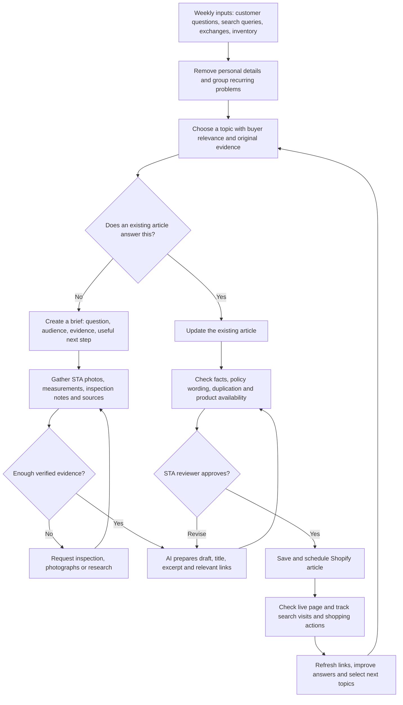

# STA customer research, SEO, AI search, blog automation and editorial outreach

Research date: November 4, 2026, America/Los_Angeles.

Capture note: This document preserves the full substantive research response delivered in this chat, including all twelve friction scenarios, proposed searches, eight conversational prompts, nine comparisons, five titles, the flowchart, automation plan, measurements and publication prospects. Formatting has been adapted for a repository document. The conversation's earlier progress observations are recorded in the companion provenance file. Linked websites were reviewed during the original research; their complete contents are not archived here.

**STA’s strongest content opportunity is helping people buy a shirt they love without regretting the fit, authenticity, or condition.** Team history can attract readers, but these buying anxieties connect more directly to a purchase.

I reviewed STA’s public website, collector discussions, and relevant publishers. The customer situations below are **research-informed hypotheses**, not findings from STA customer interviews. The keywords and chatbot prompts are proposed targets, not actual search logs or verified search-volume data.

**A useful starting point:** STA already publishes measurements, label photos, and condition assessments on some listings. Those are valuable raw materials for original articles. One issue deserves attention first: “30-Day Easy Returns” messaging sits alongside a policy specifying exchanges or store credit, with exclusions. Make that language consistent so educational content leads into a clear buying experience. [Example listing](https://stajerseys.com/products/adidas-lafc-black-gold-home-jersey), [STA return policy](https://stajerseys.com/policies/refund-policy).

## 1. Micro-Frustrations and hidden friction

| Specific moment | What the customer is really worried about | Content STA could create |
|---|---|---|
| They find their childhood jersey, but the listing says “retro,” “replica,” and “authentic” interchangeably. | “Am I paying vintage prices for something made last month?” | A visual glossary distinguishing period originals, licensed reissues, official fan replicas, player versions, and counterfeits. |
| They search the product code, get the correct team, then notice the collar looks different. | “I thought I verified it. Now I don’t trust my own judgment.” | A layered authentication checklist explaining why a matching code is only one piece of evidence. |
| Their favorite everyday shirt measures 23 inches across, but a vintage jersey is labeled XL with no measurements. | “Will this fit my stomach and shoulders, or just technically go on?” | A measurement guide using a shirt they already own, including chest, length, hem, and sleeve opening. |
| They want an oversized fit, but sizing up makes the jersey reach halfway down their thighs. | “I want loose through the body without looking swallowed.” | Side-by-side fit photographs showing width and length separately. |
| The jersey looks clean from the front, but the sponsor close-up shows tiny cracks. | “Is this normal aging, or will it fall apart after one wear?” | A photographed condition guide separating cosmetic wear from fragile prints and structural damage. |
| They want to wear the shirt to a crowded watch party, but worry a crossbody strap will rub the sponsor. | “Am I buying something I’ll be afraid to use?” | A practical “wear regularly or preserve?” guide based on garment condition. |
| A secondhand shirt smells like storage or smoke, but still has its original paper tags. | “Do I preserve its collectible condition or make it wearable?” | A tagged-versus-wearable buying guide; care advice reviewed against the actual garment and label. |
| Their dad remembers a jersey from a particular match, but the same design spans multiple seasons. | “Will I buy an expensive gift that’s almost right?” | A gift-identification worksheet using season, sponsor, collar, player, and match context. |
| A listing features the right shirt and player, but doesn’t explain when the name and number were applied. | “Is the shirt original but the printing recent?” | A guide separating shirt authenticity, nameset authenticity, application date, and match-use provenance. |
| They finally find their size, hesitate overnight, and it sells. | “How do I recognize a suitable alternative without starting over?” | Alternatives by measurements, colors, era, and silhouette, not only by club. |
| They want vintage football style, but not a team affiliation strangers will question. | “Can I enjoy the design without pretending to support a club?” | Styling guides featuring training apparel, track jackets, and clearly described STA designs. |
| They like STA’s own brand but cannot tell how its fit or construction compares with familiar sportswear. | “Why choose this instead of another secondhand branded jersey?” | Exact garment measurements, fabric details, design story, and repeatable outfit demonstrations. |

The authenticity and care concerns have observable precedents: collectors discuss copied product codes, missing labels, sponsor peeling, and the tension between removing odors and retaining tags. These discussions establish useful problems to investigate; they do not establish how common each problem is among STA customers. [Authentication discussion](https://www.reddit.com/r/KitSwap/comments/17diiju/help_spotting_fakes/), [peeling discussion](https://www.reddit.com/r/KitSwap/comments/1aldobt), [odor-and-tags discussion](https://www.reddit.com/r/KitSwap/comments/18ychhl).

**Positioning implication:** A promising message to test is **“Know what you’re buying. Know how it fits. Wear the story.”** It gives STA a specific promise that its photography, measurements, and expertise can substantiate.

## 2. The Anxious Googler queries

Use these as starting phrases to validate in Search Console and keyword research. Group related phrases into substantial articles rather than creating a separate page for every wording.

| Topic cluster | Proposed long-tail searches |
|---|---|
| Authenticity | “football shirt product code matches but is it still fake” “how to check vintage soccer jersey with missing wash tag” “does replica soccer jersey mean fake” “original vintage football shirt vs official reissue” |
| Fit | “how to know if a vintage soccer jersey will fit” “vintage football jersey oversized but not too long” “soccer jersey fits chest but tight around stomach” “how to measure pit to pit soccer jersey before buying” |
| Condition | “vintage football shirt sponsor cracking should i buy it” “what does 8 out of 10 condition mean football shirt” “how to tell if old jersey numbers are about to peel” “are pulls in a vintage soccer jersey repairable” |
| Care | “vintage football shirt smells musty scared to wash it” “how to wash old football shirt with fragile sponsor” “can i wear a vintage jersey with peeling numbers” |
| Gifts and provenance | “how to find the football shirt my dad wore in the 90s” “how to tell if football shirt nameset was added later” “player issue vs match worn football shirt difference” |
| Everyday wear and STA’s brand | “how to style a soccer jersey without wearing a full kit” “football inspired clothing without a team logo” “vintage soccer track jacket vs jersey for everyday wear” |

For Spanish-language expansion, test customer demand before commissioning full articles. Useful candidates include “cómo saber si una camiseta de fútbol vintage es original” and “cómo medir una camiseta de fútbol antes de comprar.” Have a fluent editor localize the language and examples.

## 3. AI Chatbot Conversational prompts

These prompts reveal the combinations of constraints your articles should answer.

### The buyer who no longer trusts authentication shortcuts

> I found a vintage Mexico jersey and the product code brings up the right shirt, but I’ve heard fake shirts can use real codes. The seller only shows the front and neck label. What additional photos should I request, and what would make you recommend walking away?

### The buyer whose body doesn’t match the size chart

> I usually wear XL, but football shirts sometimes fit my chest and cling around my stomach. My favorite T-shirt is 24 inches pit to pit and 29 inches long. How should I compare vintage jersey listings if I want a relaxed fit without excessive length?

### The collector who actually wants to wear the purchase

> I want an original 1990s jersey to wear regularly, not frame. One has a slightly cracked sponsor and another costs more but looks cleaner. What condition details matter most for repeated wear, and what should I ask the seller to inspect?

### The anxious gift buyer

> My dad talks about watching Club América when he was younger, and I want to buy him a jersey from that period. I don’t know the exact season or whether he would prefer a player name. How can I narrow it down without ruining the surprise?

### The customer balancing odor, tags, and value

> I found an unworn vintage shirt with its paper tags, but the seller mentions a storage smell. I want to wear it, so keeping the tags isn’t my main priority. Should I look for a clean used example instead, and what should I ask about before buying?

### The fashion buyer seeking a specific silhouette

> I want to wear football shirts with wide-leg jeans, but I’m short and oversized jerseys usually look too long. I also don’t want a tight player fit. Which measurements and garment types should I prioritize?

### The buyer considering STA’s own brand

> I like vintage soccer style, but I want something I can wear often without worrying about old prints. I’m considering an independent football-inspired brand instead. What should I compare in fabric, measurements, construction, and design before deciding?

### The heritage buyer

> I want a shirt that connects to my family’s football memories, but I can’t afford the most collectible version. I’m open to a training top, jacket, or another season. How can I find something meaningful without paying mainly for rarity?

## 4. Product-comparison dilemmas

| Decision | The actual trade-off | How STA should help |
|---|---|---|
| Period original vs licensed reissue | Historical significance versus buying a newly manufactured garment. | Show production era, licensing status, fabric, measurements, and condition separately. |
| Official fan replica vs player version | Desired silhouette and construction versus price and everyday comfort. | Explain that “replica” can mean an official supporter product; compare the particular models. |
| Cleaner blank shirt vs worn player shirt | Better condition versus emotional attachment to a player. | Photograph both and explain exactly what the premium buys. |
| Original shirt with later printing vs period-applied nameset | Visual appeal versus historical originality. | Disclose what is known and what cannot be established. |
| Less expensive marketplace listing vs specialist retailer | Lower upfront price versus inspection evidence and recourse. | Demonstrate STA’s actual process rather than assuming every marketplace seller is unreliable. |
| Tagged example vs clean used example | Collectible presentation versus immediate wearability. | Ask whether the customer intends to collect, display, gift, or wear. |
| Vintage jersey vs training top or track jacket | Iconic match design versus layering, coverage, and wardrobe use. | Compare real outfits and garment measurements. |
| Vintage original vs STA’s own brand | Historical artifact versus STA’s design, fit, and construction. | Make the brand’s own merits visible; substantiate any durability or quality claims. |
| Buy a close fit now vs wait | Immediate ownership versus comfort and uncertainty about future stock. | Offer measurement-based alternatives without promising a restock. |

A critical editorial rule: **genuine, player issue, and match worn are separate claims.** Explain the evidence required for each rather than letting customers infer one from another.

## 5. Five immediate, actionable article titles

Publish these in this order:

| Priority | Article title | Original material that would make it useful |
|---|---|---|
| 1 | **Does “Replica” Mean Fake? A Vintage Soccer Jersey Buyer’s Guide** | Annotated examples distinguishing official fan shirts, player versions, originals, reissues, and counterfeits. |
| 2 | **Will This Vintage Soccer Jersey Fit? Measure a Shirt You Own Before Buying** | A tape-measure demonstration and comparisons across actual garments. |
| 3 | **Cracked Sponsor, Pulled Threads, Faded Collar: Which Vintage Jersey Flaws Matter?** | Close-ups of different flaws, with separate cosmetic and wearability assessments. |
| 4 | **The Product Code Matches, Could This Football Shirt Still Be Fake?** | A case study showing multiple checks and the limits of photo-based authentication. |
| 5 | **Buying Dad His Childhood Football Jersey? How to Find the Right Season and Fit** | A printable identification worksheet and alternatives when the exact shirt is unavailable. |

For STA’s own brand, build a companion editorial series around **design decisions, fit demonstrations, and outfits**. Avoid presenting a new design as a historical original; let the brand earn interest through its own story.

## 6. A practical flowchart for automating STA’s blog

**Automate gathering, organizing, drafting, and checking. Keep an experienced STA reviewer responsible for the garment claims.**

**Start with a simple operating system.** Keep one content tracker with: customer problem, supporting evidence, target question, existing article, original photos, reviewer, status, publish date, and results.

Shopify supports hidden posts and scheduled publishing, so you can batch approved content without immediately publishing each draft. [Shopify publishing documentation](https://help.shopify.com/en/manual/online-store/blogs/writing-blogs/working-with-blog-posts).

For a later connected workflow, an automation platform such as n8n can coordinate the tracker, research inputs, drafting service, and Shopify integration. Treat that as an implementation project: confirm permissions and supported publishing operations before choosing the final setup. [n8n documentation](https://docs.n8n.io/).

**Give every article the same editorial requirements:**

- Answer the main question near the beginning.
- Include original STA evidence: photographs, measurements, inspection findings, or a documented customer scenario.
- Explain exceptions and what the evidence cannot establish.
- Identify the real author or reviewer.
- Link to a relevant collection and related educational article.
- Check current availability before recommending individual garments.
- End with a useful next step, such as comparing measurements or requesting a detail photograph.

Use real garment photographs for authentication and condition explanations.

For Google and AI discovery, prioritize accessible pages, clear answers, original expertise, and accurate sourcing. Google explicitly says there is no special structured markup required for its generative AI search features; no formatting trick guarantees inclusion. [Google’s AI search guidance](https://developers.google.com/search/docs/fundamentals/ai-optimization-guide).

**Suggested first-month cadence:** one strong article each week, followed by the fifth article early in month two. Increase output when STA can supply enough original evidence. Google permits useful AI assistance but warns against generating many low-value pages to manipulate rankings. [Google’s AI content guidance](https://developers.google.com/search/docs/fundamentals/using-gen-ai-content?hl=en).

Measure results at approximately 30, 60, and 90 days:

| Question | Measure |
|---|---|
| Are relevant buyers finding the articles? | Search impressions, queries, clicks, and landing-page visits. |
| Are articles helping people shop? | Clicks to collections, product views, inquiries, and assisted purchases. |
| Are explanations reducing uncertainty? | Repeated fit/authenticity questions and exchange reasons. |
| Are external placements valuable? | Referral visits, qualified inquiries, purchases, and relevant editorial links. |
| Are AI engines mentioning STA? | Referral traffic where identifiable and a consistent sample of test prompts; results are directional and variable. |

## 7. Getting an authoritative publication to cover STA

**Yes, relevant independent coverage is worth pursuing.** But an article on a prominent website does not automatically transfer its rankings to STA. Coverage can produce discovery, referral traffic, credible references, and potentially useful links. The publication controls its coverage and linking.

I have **not verified comparative rankings, traffic, or authority scores** for the prospects below. These are recommendations based on editorial relevance and demonstrated coverage.

| Prospect | Why it fits | Strongest STA pitch | Route |
|---|---|---|---|
| **Urban Pitch, first priority** | It has profiled Laundry, a vintage sports retailer, and regularly covers football culture. | A reported visit showing how STA connects vintage shirts, collectors, and local football culture. | Use its [About page](https://urbanpitch.com/about/) to identify the current route; reference its [Laundry profile](https://urbanpitch.com/laundry-portland-oregons-mecca-for-vintage-sports/). |
| **SoccerBible, strong visual prospect** | It has covered independent vintage football retail, including Quality Sportswear in Madrid. | A photographed STA archive tour, distinctive own-brand design story, or well-documented collection. | Its [official contact page](https://www.soccerbible.com/information/contact/) lists **u2us@soccerbible.com**. [Relevant store profile](https://www.soccerbible.com/lifestyle/miscellaneous/2018/09/step-inside-quality-sportswear-madrid/amp/). |
| **VERSUS, culture-led prospect** | Its coverage includes football-shirt culture and retailer collaborations. | A genuine story about identity, music, fashion, or community expressed through shirts. | Use its [editorial enquiries route](https://www.versus.uk.com/contact/). [Relevant coverage](https://www.versus.uk.com/articles/poet-vuj-go-shopping-for-the-waviest-football-shirt-of-all-time-in-the-jersey-store/). |
| **ABC7 Los Angeles, local feature prospect** | Its coverage area includes the Inland Empire, and it accepts story ideas. | A visual community event, a compelling collector reunion, or a practical consumer segment about buying vintage shirts. | Its [official contact page](https://abc7.com/post/contact-abc7-los-angeles/50737/) lists story-submission routes and **pr@abc7.com**. |

**Give the writer a story they can report, not simply a request to promote the shop.** Three promising approaches:

1. **A local archive story:** interview customers about the shirts connecting them to family, place, or a formative match. Obtain permission and document the garments.
2. **A useful measurement study:** measure an initial sample of STA stock and show how labeled sizes differ. Publish the sample, method, era, brand, and limitations; describe findings as STA inventory observations.
3. **A collector clinic:** host a real event where people learn to photograph labels, compare measurements, and recognize condition issues. Offer reporters visual access and willing interview subjects.

**The best authority may be a specialist writer rather than a news anchor.** Commission an experienced football-shirt writer to produce an original guide on STA’s site, reviewed by your team. Separately, pitch independent publications for their own reporting. An expert byline can improve the work’s credibility, but a name alone does not guarantee rankings.

Prepare a small press kit before outreach:

- A factual founder story and business timeline.
- Store and archive photographs cleared for press use.
- Three unusual garments with verified stories.
- Your authentication and condition-assessment process.
- Available interview subjects and supporting evidence.
- A useful published resource the reporter can cite.

For paid placements, buy clearly disclosed advertising for audience reach, not promises of ranking links. Google identifies paid links intended to manipulate rankings as link spam. [Google spam policies](https://developers.google.com/search/docs/essentials/spam-policies).

**My recommended first move:** clarify the exchange messaging, publish the replica/authenticity and measurement guides, then approach Urban Pitch with a documented STA store-and-community story. Those steps give both shoppers and journalists something concrete to trust.
