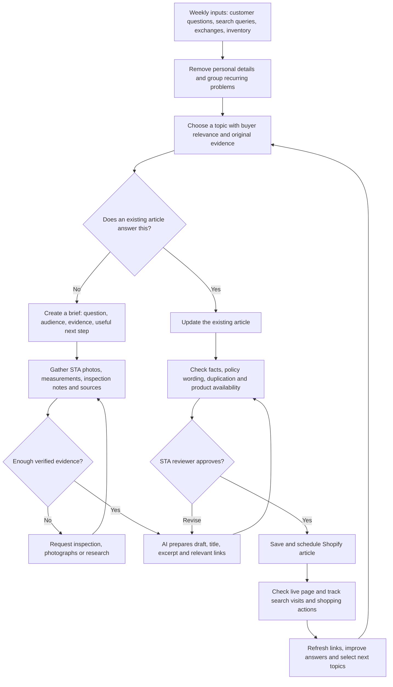

# STA blog production

As of November 4, 2026, this was a proposed workflow, not an implemented automation. No articles or Shopify settings were changed. The recommended starting cadence was one evidence rich article per week, with an experienced STA reviewer responsible for garment claims. Confirm current platform capabilities before implementation. See [[marketing-execution]] and [[free-content]].

## A practical flowchart for automating STA’s blog

**Automate gathering, organizing, drafting, and checking. Keep an experienced STA reviewer responsible for the garment claims.**

**Start with a simple operating system.** Keep one content tracker with: customer problem, supporting evidence, target question, existing article, original photos, reviewer, status, publish date, and results.

Shopify supports hidden posts and scheduled publishing, so you can batch approved content without immediately publishing each draft. [Shopify publishing documentation](https://help.shopify.com/en/manual/online-store/blogs/writing-blogs/working-with-blog-posts).

For a later connected workflow, an automation platform such as n8n can coordinate the tracker, research inputs, drafting service, and Shopify integration. Treat that as an implementation project: confirm permissions and supported publishing operations before choosing the final setup. [n8n documentation](https://docs.n8n.io/).

**Give every article the same editorial requirements:**

- Answer the main question near the beginning.
- Include original STA evidence: photographs, measurements, inspection findings, or a documented customer scenario.
- Explain exceptions and what the evidence cannot establish.
- Identify the real author or reviewer.
- Link to a relevant collection and related educational article.
- Check current availability before recommending individual garments.
- End with a useful next step, such as comparing measurements or requesting a detail photograph.

Use real garment photographs for authentication and condition explanations.

For Google and AI discovery, prioritize accessible pages, clear answers, original expertise, and accurate sourcing. Google explicitly says there is no special structured markup required for its generative AI search features; no formatting trick guarantees inclusion. [Google’s AI search guidance](https://developers.google.com/search/docs/fundamentals/ai-optimization-guide).

**Suggested first-month cadence:** one strong article each week, followed by the fifth article early in month two. Increase output when STA can supply enough original evidence. Google permits useful AI assistance but warns against generating many low-value pages to manipulate rankings. [Google’s AI content guidance](https://developers.google.com/search/docs/fundamentals/using-gen-ai-content?hl=en).

Measure results at approximately 30, 60, and 90 days:

| Question | Measure |
|---|---|
| Are relevant buyers finding the articles? | Search impressions, queries, clicks, and landing-page visits. |
| Are articles helping people shop? | Clicks to collections, product views, inquiries, and assisted purchases. |
| Are explanations reducing uncertainty? | Repeated fit/authenticity questions and exchange reasons. |
| Are external placements valuable? | Referral visits, qualified inquiries, purchases, and relevant editorial links. |
| Are AI engines mentioning STA? | Referral traffic where identifiable and a consistent sample of test prompts; results are directional and variable. |

## Evidence and related STA pages

[Complete dated research](../raw/sta-2026-11-04/STA-CUSTOMER-RESEARCH-2026-11-04.md) and [provenance and limitations](../raw/sta-2026-11-04/STA-RESEARCH-PROVENANCE-2026-11-04.md). Source website links are preserved in the report and on these pages.

Related: [[sta-customer-buying-friction]], [[sta-search-content-opportunities]], [[sta-editorial-outreach]].
